# The data explorer

The data explorer is a web page of SmartMet Server for finding data and building requests
for it, at `/api/explorer` of the server (for example `https://server.example.org/api/explorer`).
It reads the metadata of the TimeSeries, EDR and OGC API - Coverages interfaces of the
server: what data there is, which parameters, models, stations, levels and times it has, and
what area it covers. It then lets you choose the data with searches, buttons and maps instead
of typing request parameters, shows the request it builds, runs it and draws the result as
charts, maps and meteorological diagrams.

The explorer is meant for anyone who wants to find out what a server offers and get the data:
forecasters checking a model, researchers looking for observations, and developers writing a
client, who can copy the request URL or a ready script once the result looks right.

The images below were made from the test data of SmartMet Server. They show Finnish and
Scandinavian data and test descriptions such as "Title for collection pal_skandinavia"; a
production server shows its own data and descriptions.

## Contents

1. [The page](#the-page)
2. [Browsing the data](#browsing-the-data)
3. [Building a TimeSeries request](#building-a-timeseries-request)
4. [Locations and maps](#locations-and-maps)
5. [The results](#the-results)
6. [Areas: statistics, swarms and maps](#areas-statistics-swarms-and-maps)
7. [Meteograms, comparisons and ensembles](#meteograms-comparisons-and-ensembles)
8. [Soundings and vertical sections](#soundings-and-vertical-sections)
9. [Paths, cross sections and flights](#paths-cross-sections-and-flights)
10. [Observations](#observations)
11. [EDR](#edr)
12. [Coverages](#coverages)
13. [Settings, links and exports](#settings-links-and-exports)
14. [For administrators](#for-administrators)

## The page

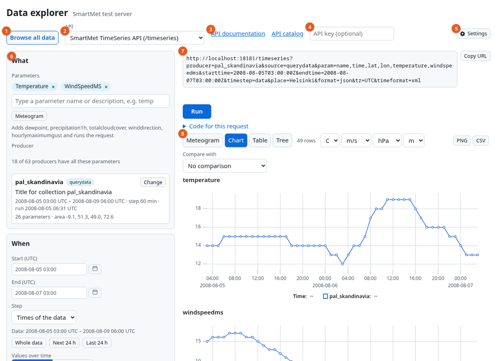

1. **Browse all data** opens the [Browse page](#browsing-the-data), a catalogue of the data of
   all the interfaces. It is on every page.
2. **API** chooses the interface to build requests for: TimeSeries, EDR or Coverages. The
   Browse page is also the first choice of this menu.
3. **API documentation** and **API catalog** open the OpenAPI documentation (Swagger UI) of
   the interfaces and the list of the interfaces of the server.
4. **API key**, for servers that require one. The key is sent with the requests of the page
   and kept in your browser.
5. **Settings**: the clock, the units, the language, and the licences of the parts of the
   page.
6. **The request form**: *What* (parameters and the producer or collection), *When* (the
   period and the time step), *Where* (the locations) and *Output* (how areas are returned,
   the language of the names, extra columns).
7. **The request** as a URL. It is updated as you make choices, and it tells what is still
   needed before the request can be run. **Run** sends it.
8. **The results**, as tabs of views of the same data.

## Browsing the data

The Browse page lists every dataset of the server as a card, with the interfaces offering it.
A dataset with the same name in several interfaces (a model in TimeSeries, EDR and Coverages,
say) has one card. The kinds of data (forecast models, ensembles, observations, soundings,
radar, marine, air quality, climate) and the themes of the parameters (temperature, wind,
precipitation, clouds and fog, ...) are buttons with counts; together with the search they
narrow the cards. The search covers the names and descriptions of the datasets and of their
parameters.

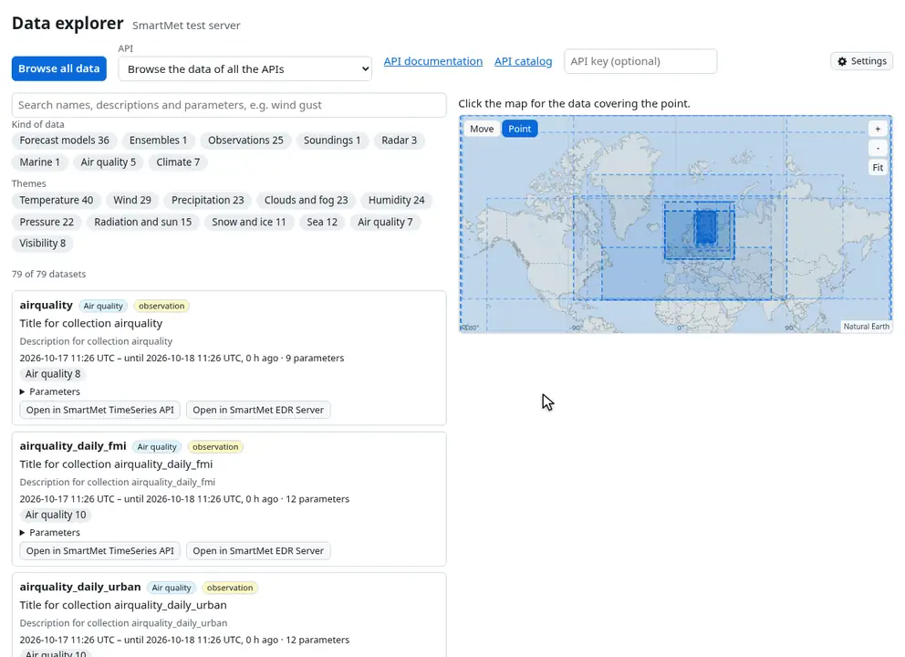

Each card shows the kind of the data, where it comes from, its period and how old the
latest data is, the themes and the parameters (the matching ones when you have searched). An
**Open in ...** button opens the dataset in that interface with the parameters searched
for already chosen. When an interface has the dataset from several sources, for example
both as querydata and as GRIB, the buttons name the source.

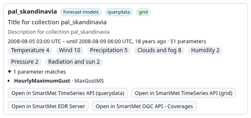

The map shows the areas of the datasets listed. A point clicked on the map keeps only the
datasets covering it; **Anywhere** removes the point.

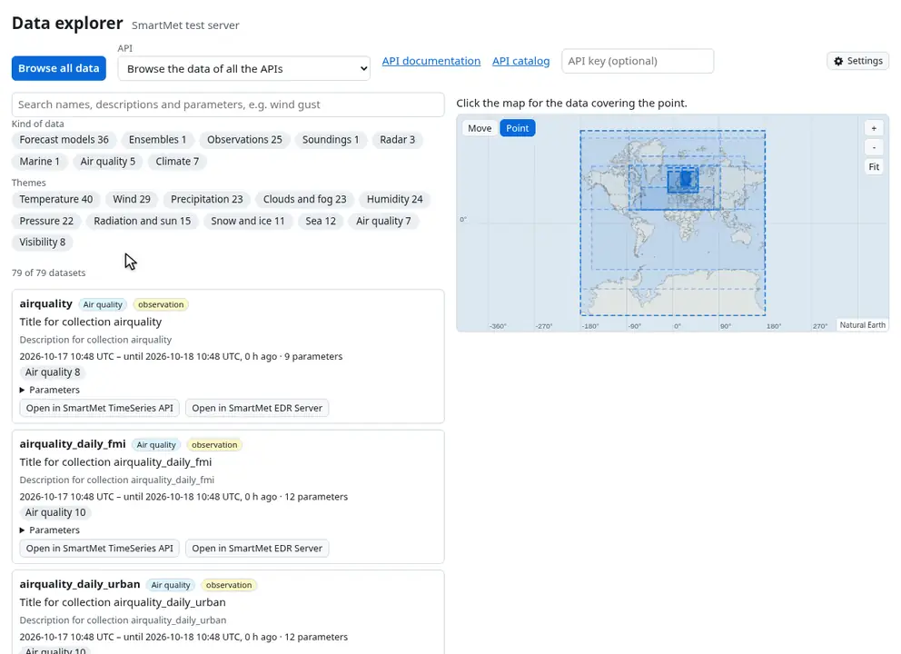

## Building a TimeSeries request

The TimeSeries interface returns values of parameters at locations over a period, from model
data, observations and other point data.

**What.** Start typing in **Parameters** to find parameters by name or description; the
suggestions tell how many producers have each one. The **Producer** search lists only the
producers having all the chosen parameters, and the parameter search only the parameters of
the chosen producer, so you can start from either end. A producer card shows its period,
time step, model run, levels and area; **Change** chooses another one.

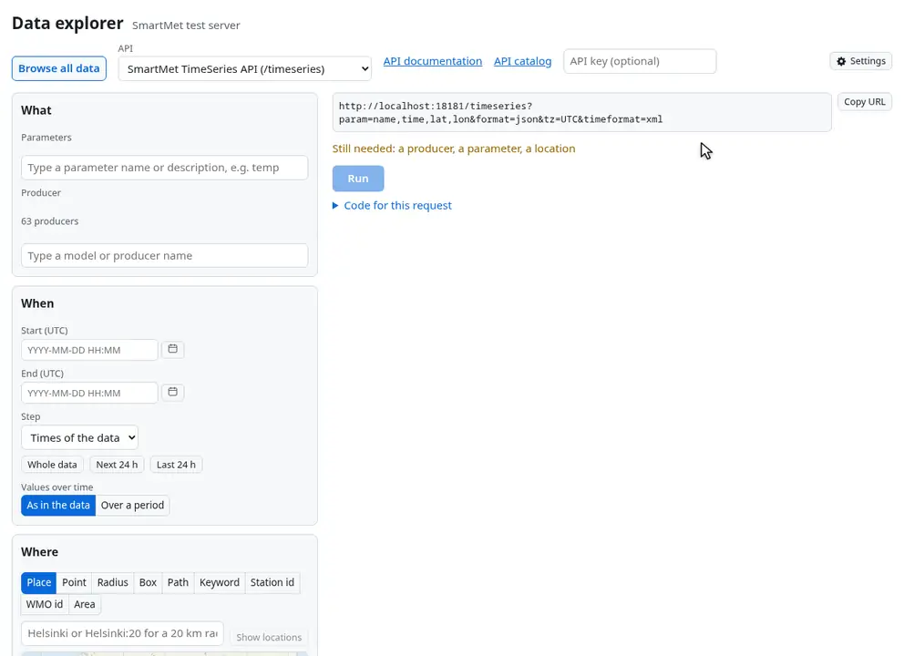

For data on levels the card is followed by the levels (none chosen means all of them, for
grid data the default level of each parameter), and for grid data by the model runs,
geometries, ensemble members and level types of the producer. The chosen levels and members
of grid data are counted as levels and members, not as locations, and three or more levels
of one location give the vertical views. Buttons such as **Meteogram** and **Skew-T log-p** add the parameters such a view
needs and run the request.

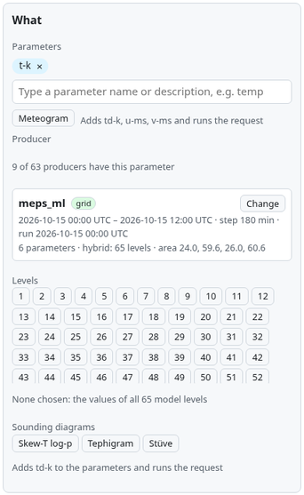

**When.** The period is given as UTC times in the clock of the settings, with a date picker
button. **Whole data**, **Next 24 h** and **Last 24 h** set the period from the data of the
producer (for observations **Last 24 h**, **Last week** and **Last month**, as their
history can go back a long time). The time step is that of the data or a fixed one. **Over
a period** asks for values aggregated over a period around each time (a maximum, a sum, a
mean, ...), with the function recommended for each kind of parameter.

**The request and its code.** The URL of the request is always shown. Under **Code for this
request** the same request is given as bash, Python, R and JavaScript, and as loops that
repeat it for consecutive periods, for fetching a long history piece by piece.

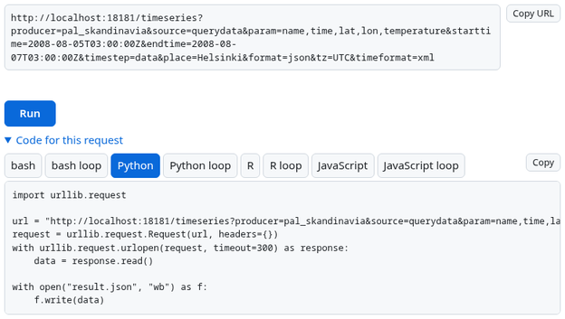

## Locations and maps

**Where** chooses the locations:

| Mode | The locations | Example |
|---|---|---|
| Place | a place name, or a name and a radius in km | `Helsinki`, `Helsinki:20` |
| Point | a longitude and latitude, or a click on the map | `25,60.2` |
| Radius | a point and a radius in km, or a drag on the map | `25,60.2:25` |
| Box | west, south, east and north, or a drag on the map | `23,61,27,63` |
| Path | points along a line, clicked on the map | `24.3,59.8,25,60.2,25.8,60.5` |
| Keyword | a location keyword of the server | |
| Station id | station numbers, or stations clicked on the map | `100971,101004` |
| WMO id | WMO station numbers | `2963,2974` |
| Area | an area name of the server | `uusimaa` |

While a place or an area name is typed, the names the server knows are suggested: for a
place the places whose names begin with the text, the largest first, and for an area the
areas of the server. A place name shared by several places is completed with its area, such
as `Portland,USA`. The suggestions come from `/timeseries/api/places` and
`/timeseries/api/areas`; a server without them suggests nothing.

The map draws the area of the chosen producer. A box or a radius drawn on the map also
narrows the producers to those covering it: below, a box over Iberia leaves the 6 producers
whose data reaches it, and a radius around Helsinki brings back the 22 that have
temperatures there.

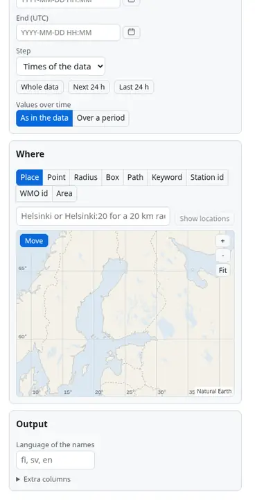

The maps of the page draw the land, the lakes and the borders from Natural Earth data that
comes with the server, so no online map service is needed.

## The results

The results open as tabs. Which tabs there are depends on the data: **Chart**, **Table** and
**Tree** (the JSON response) always; **Map** when there are several points; **Meteogram**
when the parameters allow one; **Profile**, **Section** and **Sounding** for data on levels;
**Cross section** and **Along the path** for paths. The head of the results gives the
number of rows, locations and levels, has the unit choices (temperature, wind speed,
pressure, height), and saves the view as **PNG** or the rows as **CSV**.

The charts show the values of each location and parameter over time, with the values at the
pointer below them. One location can be compared with another producer (see below).

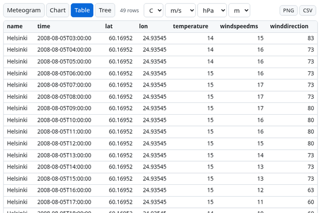

## Areas: statistics, swarms and maps

A box, a radius, an area or a list of stations contains many points. **Output** chooses
what is returned for them:

* **Statistics** (the default for areas): the server computes the median and the 10, 25, 75
  and 90 % percentiles of the area at each time, so the response stays small whatever the
  size of the area.
* **Every point**: the values of every grid point or station. More than 20 locations are
  drawn as their median and percentiles, as **All locations** (a swarm of thin lines coloured
  from south to north, the median on top), or as the **Probability** of a threshold.

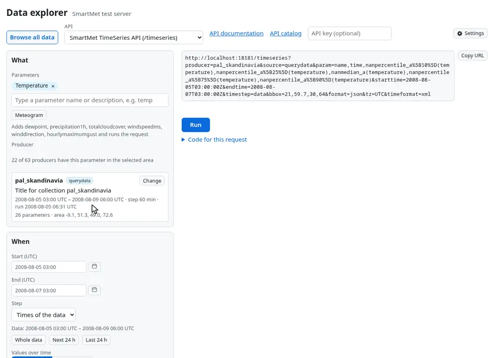

The **Map** tab colours the values of every point at one time, as cells for grids and dots
for stations. The colours are those of the production products of the server when it has
them for the parameter, otherwise a scale fitted to the data, and both the colours and the
scale can be changed. The time slider plays the times. A value clicked on the map gives the
time series of that point below the map.

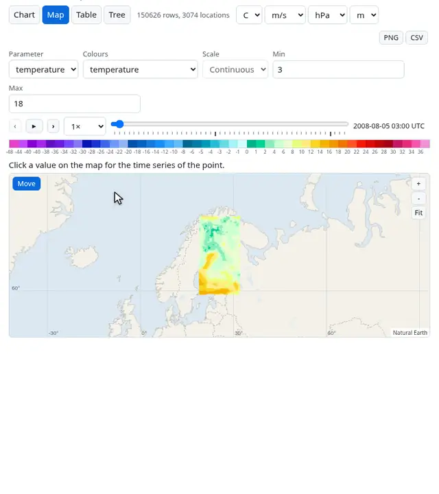

## Meteograms, comparisons and ensembles

**Meteogram** draws temperature and dew point, precipitation, cloud cover, and wind and gusts
with wind barbs, for one location.

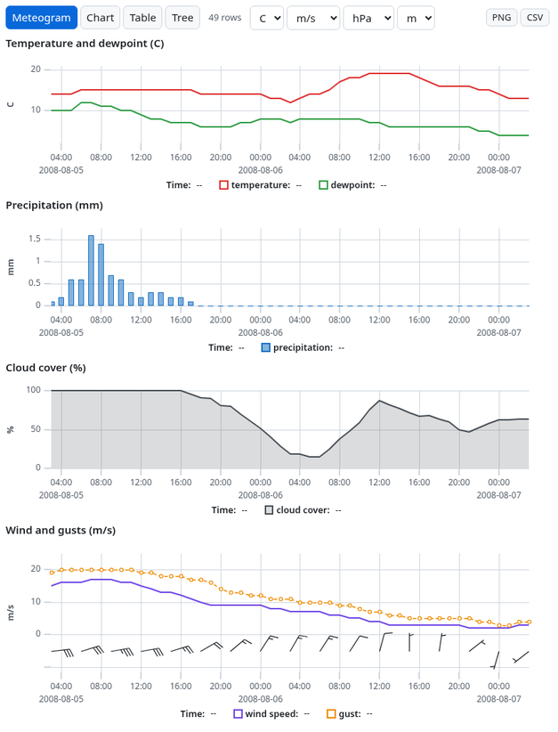

For one location, **Compare with** draws the same parameters from another producer covering
the place and period, and tells the mean difference and the mean absolute difference.

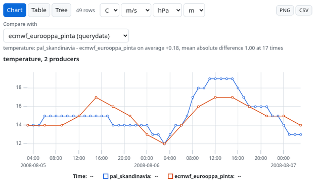

Ensembles are drawn as the median and percentiles of the members, as **All members**, or as
the **Probability** that the members are above or below a threshold. The meteogram of an
ensemble is an EPSgram: the median and the 10-90 % range of the members.

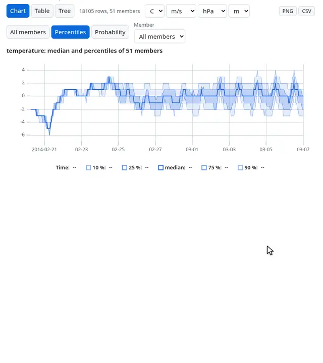

## Soundings and vertical sections

Data on pressure, model, height or depth levels gives vertical views of one location.

**Sounding** draws a thermodynamic diagram: a skew-T log-p diagram, a tephigram or a Stüve
diagram, with the dry and moist adiabats and mixing ratio lines, the temperature, the dew
point, the wind barbs of the levels and the path of a lifted surface parcel. The pointer
gives the values at its level. The time slider steps through the times, and **All times**
draws every sounding of the period at once.

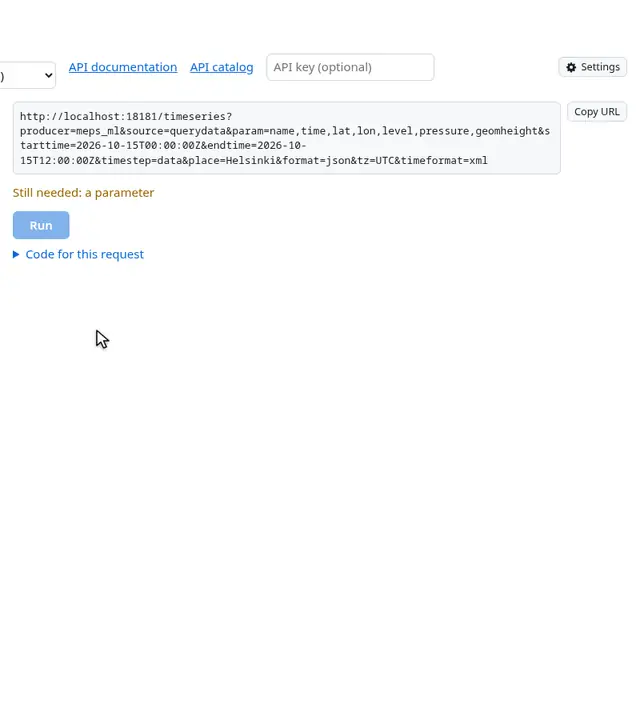

**Add a panel** shows another sounding beside the first one, by default the next time or
location, with shared scales so that the panels compare. **Compare with** draws the
soundings of another producer, such as observed soundings, within three hours of each time.

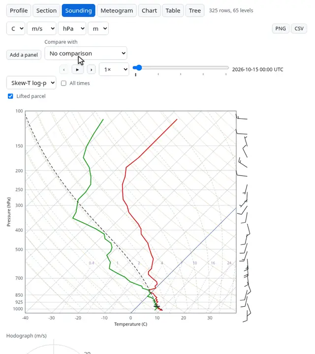

Below the diagram are an analysis of the sounding (CAPE, CIN, the LFC and EL, the lifted
index, the freezing level, the K-index, total totals, precipitable water and the 0-6 km
shear), a hodograph coloured by height, and a table of the values of every level.

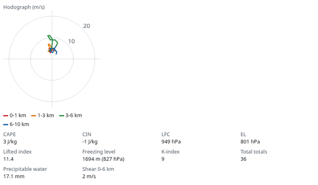

**Section** is a time-height section of one location: a parameter coloured over time and
height, with isotherms, wind barbs and the 90 % humidity line as overlays and flight
levels on the side. **Top** limits the height, and **Vertical axis** chooses pressure,
height or the model levels. **Profile** draws the values of each parameter against height.

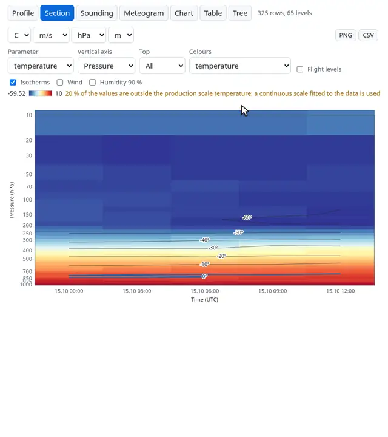

## Paths, cross sections and flights

In the **Path** mode you click points on the map; **Undo** and **Clear** edit the path. The
values are asked at the marked points or at points every so many kilometres along the
path. For data on levels the result opens as a **Cross section** along the path, with
the same overlays as the time-height section and its own time slider.

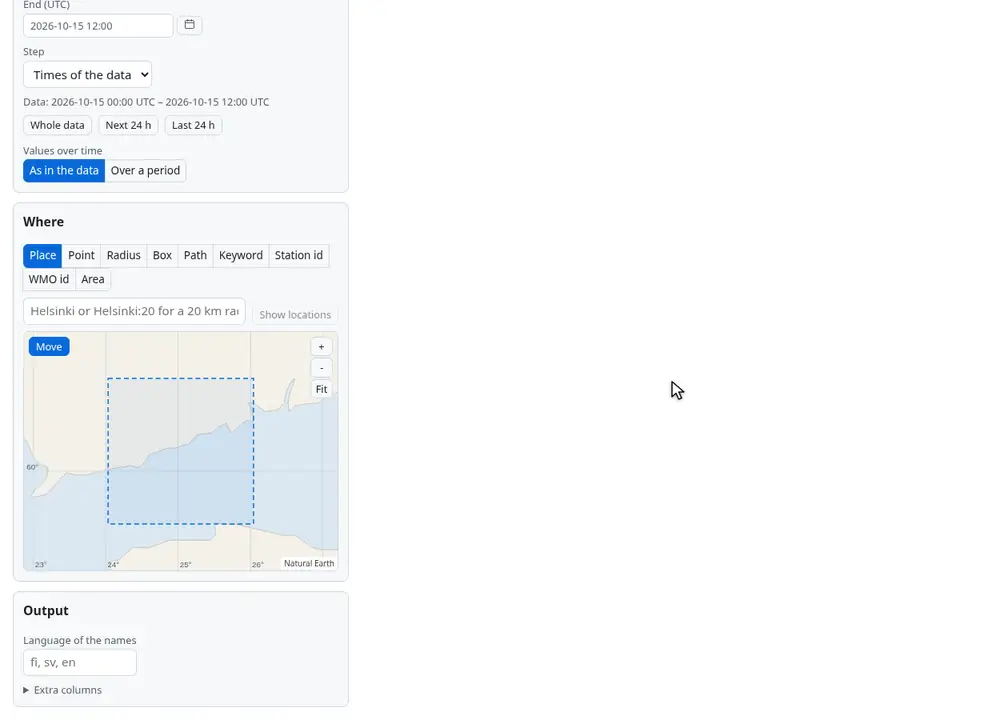

A **Departure** and an **Arrival** time make the path a flight: the cross section shows the
values at the times the points are passed, and **Along the path** charts the values met on
the flight at the chosen level.

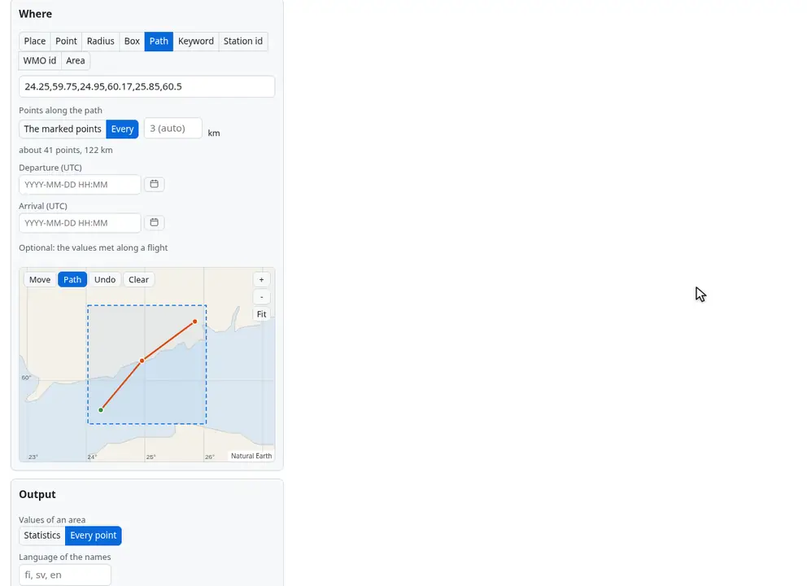

## Observations

Observation producers list their stations, which can be chosen on the map, by name or by
their numbers. With stations chosen, the explorer lists the **Sensors** of each parameter at
those stations in the period, marking the default sensor; the buttons add other sensors.
**Quality** chooses which values to accept by their quality codes, and the codes can be
shown in the table.

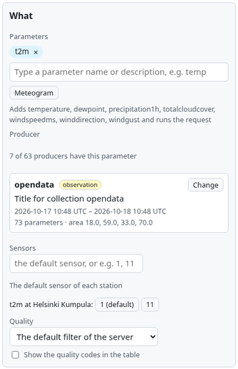

Observations are returned only for the times and stations that reported them, so a period
without reports gives an empty result; the explorer then says so below the request. Errors
of the server are shown there too:

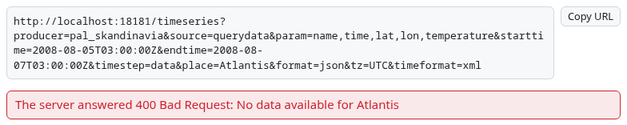

## EDR

The OGC API - Environmental Data Retrieval module works on the collections of the EDR
interface. The parameter and collection searches narrow each other as in TimeSeries, and the
query types of the collection are offered: **Position**, **Radius**, **Area**, **Cube**,
**Trajectory** and **Locations**. The times and levels come from the extents of the
collection, and the output is CoverageJSON or GeoJSON. The results are drawn with the same
views as in TimeSeries.

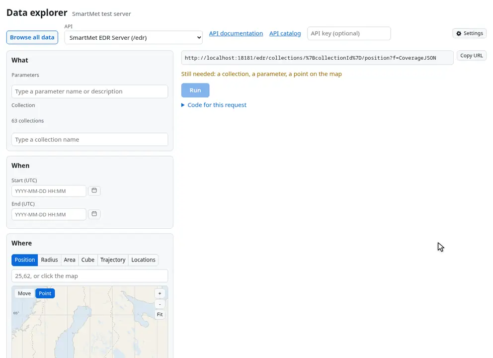

## Coverages

The OGC API - Coverages module downloads gridded data as files: GRIB 2, GRIB 1, NetCDF,
GeoTIFF or querydata. The collection card tells the native projection, grid size and
resolution of the data. A **Box** drawn on the map (or typed) crops it, the **Projection**
reprojects it to the native grid, longitude and latitude, Web Mercator or the projections
configured for the server (here ETRS-TM35FIN and ETRS89 LAEA Europe), and an optional grid
size resamples it. As these change, the map shows the area of the output and the page
estimates the grid size and the size of the download.

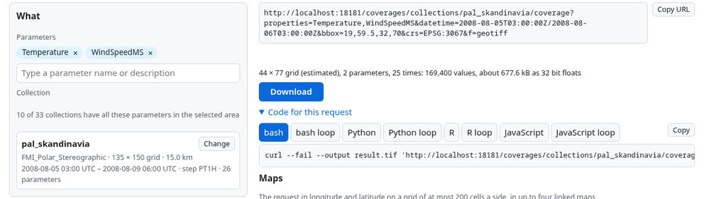

**Show maps** draws the request on up to four linked maps, each with its own parameter,
level and colours. The maps move together and share the time slider, and a value clicked on
one gives the time series of the point in every map.

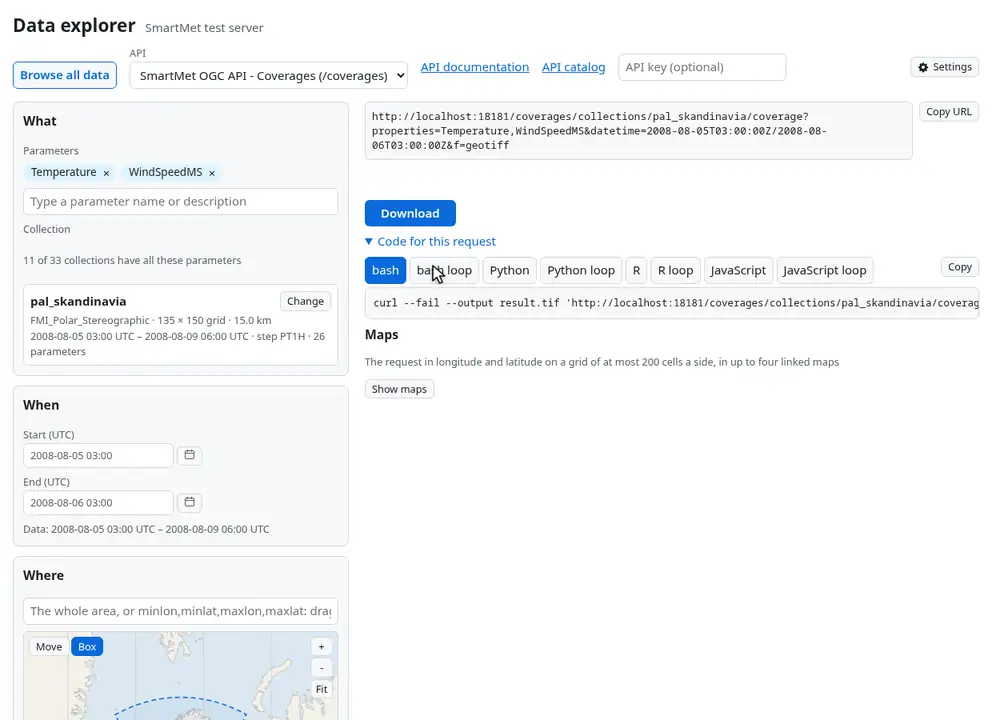

## Settings, links and exports

**Settings** chooses the clock (24 or 12 hours), the units of temperature (C, F, K), wind
speed (m/s, knots, km/h, mph), pressure (hPa, Pa, inHg) and height (m, ft), and the
language of the page (English, Finnish or Swedish). Times are always UTC. Without your own
choices the page follows the defaults of the server, and then your browser language.

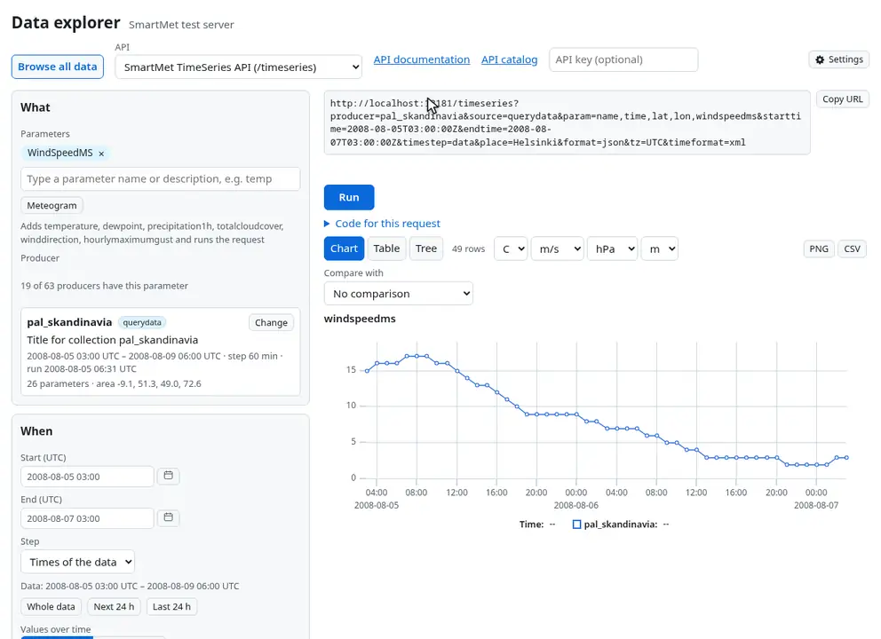

**Links.** The choices of the page are kept in its address after `#`, so a view can be
bookmarked or shared as a link, and the page opens the last view again when it is opened
without one. The page keeps nothing on the server: the views and the preferences are in
the local storage of the browser, and no cookies are used.

**Exports.** **PNG** saves the view shown, and **CSV** the rows of the result.

## For administrators

The explorer is part of the API catalog of the server (`/api`, RFC 9727) and is served at
`/api/explorer` whenever the catalog is. In a cluster the frontend serves it with the merged
catalog of its backends, so the explorer sees every interface of the cluster, and its
requests go through the frontend like any other. It lists the interfaces whose plugins
publish an OpenAPI definition with a kind: TimeSeries and EDR (`smartmet-plugin-edr`) and
Coverages (`smartmet-plugin-download`).

**Packages.** The page is in `smartmet-library-spine` (`/usr/share/smartmet/explorer`), and
its charts use uPlot from `smartmet-uplot` (`/usr/share/smartmet/uplot`). The production
colours come from the palettes of `smartmet-qdless` (`/usr/share/smartmet/qdless`); without
them the maps use fitted colour scales. When files are missing the server logs which ones and
leaves the explorer out.

**Configuration.** The settings are in the `api_catalog` group of the server configuration
(on a cluster, the configuration of the frontend). All are optional:

```
api_catalog:
{
  title          = "SmartMet Server APIs";   # shown in the header of the page
  explorer       = true;                     # false leaves /api/explorer out
  explorer_dir   = "/usr/share/smartmet/explorer";
  uplot_dir      = "/usr/share/smartmet/uplot";
  palette_dir    = "/usr/share/smartmet/qdless/palettes";
  palette_config = "/usr/share/smartmet/qdless/qdless.conf";

  # The defaults of the region and the users of the server
  explorer_defaults:
  {
    center      = [25.0, 62.0];      # longitude, latitude of the first map view
    zoom        = 4;
    language    = "fi";              # en, fi or sv
    clock       = "24";              # "24" or "12"
    examples:   { place = "Helsinki"; fmisid = "100971,101004"; wmo = "2963,2974";
                  keyword = "synop_fi"; area = "Uusimaa"; };
    projections = ["EPSG:3067 ETRS-TM35FIN", "EPSG:3035 ETRS89 LAEA Europe"];
    units:      { temperature = "C"; speed = "ms"; pressure = "hPa"; height = "m"; };
  };
};
```

Without `explorer_defaults` the explorer assumes no region: the maps open on the whole
world, the location fields show neutral examples, and the units and the clock follow the
language of each browser. The `examples` are the hints of the location fields, so they
should be places, stations, keywords and areas the server knows. The `projections` are
offered for Coverages downloads in addition to the native grid, longitude and latitude and
Web Mercator. A user's own choices in the settings override these defaults.

**Licences.** uPlot is MIT licensed and the Natural Earth map data is in the public domain;
the settings menu of the page lists them.

## Making the images of this guide

The images are made by `docs/tools/explorer-capture/` from a server running the test data of
the frontend plugin with the TimeSeries/EDR, download, querydata, grid and observation
modules. See its [README](tools/explorer-capture/README.md).
