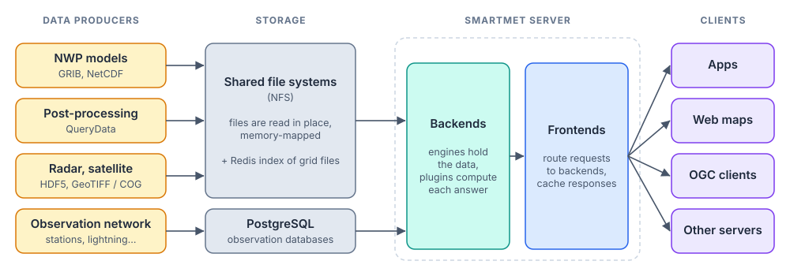
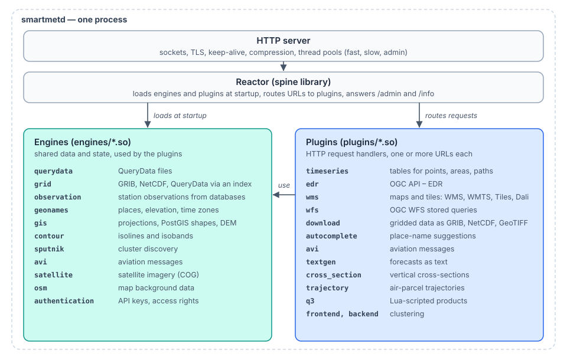
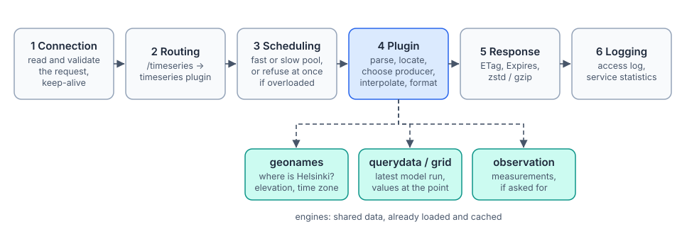
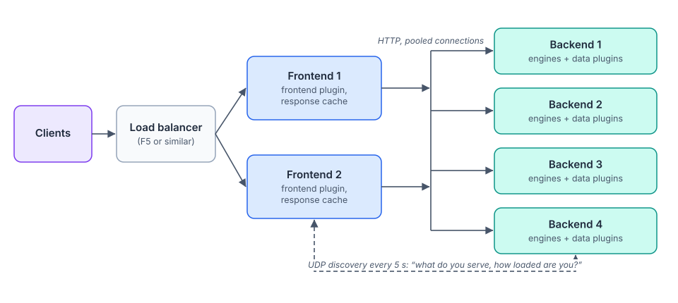
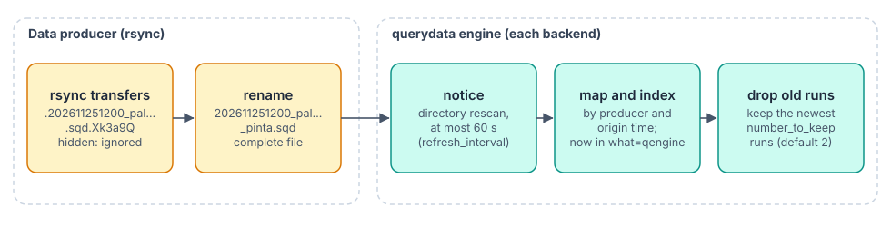
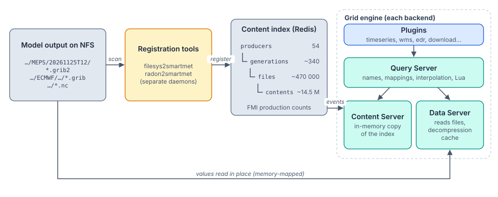
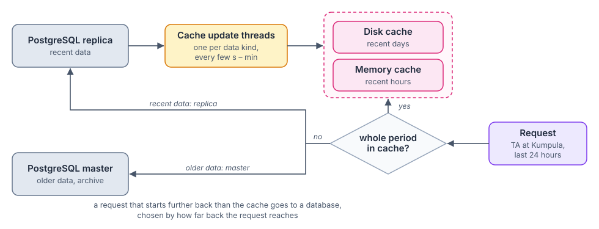
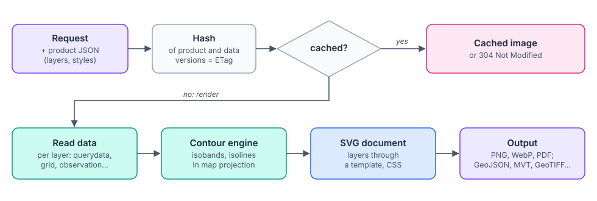

# How SmartMet Server works

This tutorial explains what happens inside SmartMet Server: how a request is answered,
where the data comes from, how a new data file becomes visible to clients, and where the
caches are. It is written for IT professionals who run the server, configure it, or
produce the data it serves (QueryData, GRIB, NetCDF, HDF5, GeoTIFF), but who have not
worked on the server's own code. No C++ is needed; the examples are requests, small
configuration snippets and diagrams.

The component developer guides go deeper into each part. They are linked at the end of
each section and listed in [§18](#18-glossary-and-further-reading).

## Contents

1. [The big picture](#1-the-big-picture)
2. [Anatomy of the smartmetd process](#2-anatomy-of-the-smartmetd-process)
3. [The life of a request](#3-the-life-of-a-request)
4. [Frontends and backends](#4-frontends-and-backends)
5. [Gridded data, path 1: QueryData](#5-gridded-data-path-1-querydata)
6. [Gridded data, path 2: the grid engine](#6-gridded-data-path-2-the-grid-engine)
7. [Radar, satellite and map data](#7-radar-satellite-and-map-data)
8. [Observations](#8-observations)
9. [Locations and geography](#9-locations-and-geography)
10. [What happens to the numbers](#10-what-happens-to-the-numbers)
11. [Map products: WMS and contouring](#11-map-products-wms-and-contouring)
12. [A tour of the other interfaces](#12-a-tour-of-the-other-interfaces)
13. [Caching at every layer](#13-caching-at-every-layer)
14. [Configuration walkthrough](#14-configuration-walkthrough)
15. [Operating the server](#15-operating-the-server)
16. [Guidance for data producers](#16-guidance-for-data-producers)
17. [Troubleshooting by symptom](#17-troubleshooting-by-symptom)
18. [Glossary and further reading](#18-glossary-and-further-reading)

---

## 1. The big picture

SmartMet Server turns weather data into products **when they are requested**. It does
not render a catalogue of maps or time series in advance. Instead it keeps the raw data
(model runs, observations, radar and satellite images) close at hand, mostly memory-mapped
or cached, and computes each answer from it: the temperature forecast for a place, a map
tile of precipitation, a GRIB subset of a model run, the observations of a station.



Three design choices explain most of the server's behaviour:

* **On-demand computation.** A request names the data, place, time, projection and format
  it wants; nearly any combination is possible because nothing is precomputed. The cost
  is that every request does real work, which is why the caches (§13) matter.
* **Data stays where the producer put it.** The server reads files from the directories
  the producers write to, and observations from the databases they are stored in. Getting
  new data into the server means writing a file into the right place, not uploading or
  importing it (§16).
* **Everything is a plug-in.** The daemon itself only handles HTTP. Data access lives in
  *engines* and request handling in *plugins*, both loaded at startup from configuration
  (§2). A server that only serves observations loads only what it needs.

### The scale of it

A snapshot of FMI's production on 25 November 2026, taken from the server's own status
requests (`/admin?what=servicestats`, `/info?what=qengine` and the grid engine's status
page). FMI runs several clusters; the two below serve external clients and FMI's open
data service.

| | Client cluster (6 backends) | Open data cluster (3 backends) |
|---|---|---|
| Requests per hour (afternoon) | 1.5 million (about 425 per second) | 270 000 (about 75 per second) |
| Requests per day | tens of millions | 5.7 million |
| Average response time / CPU time | 23 ms / 11 ms | 97 ms / 53 ms |
| QueryData producers / files loaded per backend | 187 / 12 700 | 22 / 59 |
| Grid producers / model runs | 54 / 339 | not used |
| Grid files / individual grid fields indexed | 470 000 / 14.5 million | not used |
| Observation stations known | 19 000 in 222 countries | 18 000 in 222 countries |

The traffic differs by cluster. On the client cluster most requests are time series
(`/timeseries`, 70 %) and maps (`/wms`, 15 %), and typical answers take milliseconds: a time
series 17 ms, a WMS map 23 ms, an autocomplete lookup under 1 ms. The open data cluster
answers mostly WFS stored queries (90 % of its requests, 45 ms on average), plus EDR,
downloads and time series. Long requests such as GRIB downloads take longer because they
stream large amounts of data.

---

## 2. Anatomy of the smartmetd process

The server is one process, `smartmetd`, configured with one main file (by convention
`/etc/smartmet/smartmet.conf`). At startup it reads which **engines** and **plugins** to
load, and loads each from its own shared library:



**Engines** hold data that many requests share: the loaded model runs, the observation
caches, the place-name database. They do not answer HTTP requests themselves (apart from
admin requests). **Plugins** answer requests and use the engines to do it. The timeseries
plugin, for example, uses geonames to find "Helsinki", querydata or grid to read the
forecast, and observation to read the measurements.

### Startup

1. The server binds its port and starts accepting connections almost at once.
2. Engines and plugins are loaded and initialised **in parallel**. Initialisation is
   where the heavy work happens: the querydata engine maps its files, the grid engine
   loads the content index from Redis, the observation engine fills its caches, geonames
   reads the place-name database.
3. A plugin that needs an engine waits for that engine to finish.
4. Until a plugin is ready, its requests get `503 Service Unavailable`.
   `/admin?what=waitforready` answers once everything is up.

A production backend therefore takes from tens of seconds to a few minutes to become
useful, depending mostly on how much data it has to index. Load balancers must check
readiness, not just whether the port is open (§15).

### Threads

The server answers many requests at once. Socket I/O runs on a small set of I/O threads
(6 by default); the requests themselves run in three **thread pools**:

| Pool | Used for |
|------|----------|
| `fastpool` | Requests the plugin says are quick, and everything a frontend proxies. |
| `slowpool` | Other requests (heavy computations, large downloads). |
| `adminpool` | `/admin` and `/info`, so that status checks work even under load. |

Each pool has a queue. When the queue is full, or the server has more active requests
than its throttle allows, a new request is refused at once with a "high load" reply
rather than left waiting. A frontend then sends it to another backend (§4).

### Reloading without restarting

Most engines watch their data and configuration and pick up changes while the server
runs: new data files, changed parameter mappings, an updated place-name database, a new
WMS product file. Changing which engines and plugins are loaded, or most server-level
settings, needs a restart.

Further reading: the server and spine developer guides.

---

## 3. The life of a request

Take one request and follow it through a backend:

```
GET /timeseries?place=Helsinki&param=time,temperature,windspeedms&format=json
```



1. **Connection.** An I/O thread reads the request. The server checks the basics: a
   `Host` header for HTTP/1.1, sizes within limits. The connection is kept open for the
   next request afterwards (HTTP keep-alive).
2. **Routing.** The URL path `/timeseries` is looked up in the table of registered
   handlers. The timeseries plugin registered it at startup. An unknown path gives 404
   (or, on a frontend, is proxied to a backend).
3. **Scheduling.** The plugin says whether the request is fast or slow, and the request
   is queued to that pool. If the server is overloaded it is refused here.
4. **The plugin works.** In a pool thread, the timeseries plugin:
   * parses the parameters (`place`, `param`, `starttime`, `timestep`, `tz`, `lang`…);
   * asks the **geonames** engine for Helsinki: coordinates, elevation, time zone,
     country;
   * chooses a **producer** (data source). No `producer=` was given, so it takes the
     first configured producer whose data covers Helsinki (§5);
   * gets a handle to the latest model run from the **querydata** engine and
     interpolates temperature and wind speed to the point for every time step (§10);
   * formats the table as JSON.
5. **Response headers.** The plugin sets `Content-Type`, `Cache-Control`, `Expires` (when
   the next model run is expected) and usually an `ETag` that identifies this exact
   answer.
6. **Compression.** If the client accepts it and the response is large enough, the
   server compresses it with zstd or gzip.
7. **Logging.** The request is written to the access log of its URL, and counted in the
   service statistics (`/admin?what=servicestats`).

The response looks like this:

```json
[{"time":"20261125T170000","temperature":-2.1,"windspeedms":4.3},
 {"time":"20261125T180000","temperature":-2.4,"windspeedms":4.1}, …]
```

### Conditional requests

Weather data changes only when a new model run or observation arrives, so most requests
are repeated with the same answer. Clients should send the `ETag` they got back in
`If-None-Match`. If the data has not changed, the server answers `304 Not Modified`
without a body, often without computing anything. Clients that add random parameters to
URLs to "bust caches" defeat this and only make the server work harder. The
[HTTP client guide](HTTP-Client-Guide.md) explains the headers in detail.

### Limits

Requests can be limited per plugin: a maximum time to spend (`request_timeout`), and in
the data plugins maximum numbers of locations, time steps, grid points or a search radius.
These protect the server from requests that would read gigabytes to answer. Production
configurations must set them; the defaults are unlimited.

---

## 4. Frontends and backends

A single server is enough for development. Production runs **clusters**: a few
**frontends** that receive all requests, and several **backends** that do the work.
Every node runs the same `smartmetd`; what differs is the configuration.



### Discovery

Backends do not need to be registered anywhere. Each frontend asks every backend on its
list, over UDP, every 5 seconds: "what do you serve?" Each backend answers with the URLs
its plugins handle, its load average, and the names of its public info requests. The
frontend builds a routing table from the answers: for each URL, the backends that can
serve it.

* A backend that does not answer in time disappears from the table within about
  7 seconds.
* A backend that is **paused** (`/admin?what=pause`), **shutting down** or **overloaded**
  stops answering, so it is taken out of rotation without failing requests already in
  progress.
* A backend that comes back is used again from its first answer.

Because routing is by URL, backends do not all need the same plugins. A backend without
the `/avi` plugin is simply never sent `/avi` requests.

### Forwarding

For each request the frontend picks one backend for the URL, by default at random. Other
strategies are available (least connections, load-weighted, sticky sessions by cookie or
client address). If the chosen backend refuses with "high load", the frontend takes it out
of rotation for a moment and tries another. This is deliberate: it sheds load from a
struggling backend instead of queuing more work on it.

A request can also be sent to one particular backend by putting its name first in the
path, which is useful for diagnostics:

```
https://frontend.example.org/backend3.example.org/info?what=qengine
```

### The frontend cache

Before forwarding a request, the frontend first asks the backend only for the `ETag` of
the answer. If the frontend already has a body cached under that `ETag`, it answers from
its cache without the backend computing the result. Otherwise it forwards the request,
streams the answer to the client, and stores it.

Two consequences:

* Plugins that give no `ETag` are never cached at the frontend. Every request reaches a
  backend.
* The cache key is the ETag, not the URL. Many URLs that produce the same map share one
  cached copy.

### Cluster-wide information

The frontend combines information from all backends: `/info?what=backends` lists who
serves what, and `/info?what=qengine` shows which data each backend has loaded. Backends
are expected to have the same data, but because each one scans its directories on its own,
for a few seconds after a new model run arrives some backends have it and some do not
(§5).

Further reading: the frontend plugin and sputnik engine developer guides.

---

## 5. Gridded data, path 1: QueryData

**QueryData** (`.sqd`, `.fqd`) is FMI's own format for gridded and point data. One file
holds one data set: parameters × levels × times × grid points (or stations), with the
projection and the origin time of the run. It is designed to be **memory-mapped**: the
server maps the file and reads the values it needs directly, without parsing or copying.
Most post-processed FMI products (edited forecasts, statistically corrected models,
analyses, climate data) are QueryData.

### Why memory-mapping

A production backend may have 1–2 TB of RAM, and that is still far less than the data it
serves. Reading everything into memory is therefore not an option, and neither is reading
a file for every request. Memory-mapping solves both: a mapped file looks like memory to
the server, and the **kernel** pages in the parts that requests actually touch, keeps the
frequently used parts in RAM, and drops the rest when memory is needed. The server needs
no paging or caching logic of its own for the data files, and a file mapped by many
requests at once is in memory only once. The grid engine's Data Server maps GRIB and
NetCDF files the same way.

### From a file to data the server can use

The querydata engine is configured with a list of **producers**. Each producer is a
directory and a file-name pattern:

```
producers = [ "pal_skandinavia", "ecmwf_eurooppa_pinta", "ecmwf_maailma_piste" ];

pal_skandinavia:
{
    alias          = ["pal", "kap"];
    directory      = "/smartmet/data/pal/skandinavia/pinta/querydata";
    pattern        = ".*_pal_skandinavia_pinta\.sqd$";
    type           = "grid";
    leveltype      = "surface";
    number_to_keep = 2;           # model runs to keep
    update_interval = 3600;       # seconds between runs, for Expires headers
};
```

What happens to a file:



1. Files usually arrive by rsync, which writes a hidden temporary file (its name starts
   with a dot) and renames it when the transfer is complete. The engine skips all names
   starting with a dot, so it only ever sees complete files (§16).
2. The engine watches each producer's directory. It rescans every
   `refresh_interval_secs` (60 s by default) and reacts to files that were created or
   deleted.
3. A new file matching the pattern is opened and memory-mapped. Its **origin time** (the
   model run time stored in the file) decides its place among the runs of that producer.
   If two files have the same origin time, the one modified later wins.
4. The newest `number_to_keep` runs are kept; older ones are dropped from the index. A
   request still using an old run keeps it alive until the request finishes.
5. From that moment `/info?what=qengine` lists the file, and requests use it.

### Choosing a producer

A request can name the producer (`producer=pal`). If it does not, the engine walks the
configured `producers` list **in order** and takes the first producer whose latest run
covers the requested point. The list is therefore ordered from the most detailed, smallest
area to the coarsest global one: a point in Finland gets the high-resolution local model,
a point in Australia falls through to the global one.

### Other producer types

* `multifile = true` treats all files of a directory as one data set, for example
  observations in daily files or radar images in 5-minute files.
* `type = "points"` is station-based QueryData.
* `lazy = true` producers (radar GeoTIFF and ODIM HDF5 files, see §7) are only
  catalogued at startup and decoded when first used.

Further reading: the querydata engine developer guide, and newbase's `querydata.md` for the
file format itself.

---

## 6. Gridded data, path 2: the grid engine

Numerical weather models produce **GRIB** (editions 1 and 2) and **NetCDF**, often tens of
thousands of files per model run. The grid engine serves these without converting them.
It also reads QueryData, so a single interface can cover all gridded data.

Unlike the querydata engine, the grid engine does not scan directories. It works from an
**index of contents**, kept in Redis and shared by all servers:



The vocabulary:

| Term | Meaning | FMI production |
|------|---------|----------------|
| **Producer** | A data source, typically one model (MEPS, ECMWF, …) | 54 |
| **Generation** | One model run of a producer | ~340 |
| **Geometry** | A grid definition (projection, area, resolution), identified by a number | ~360 |
| **File** | One GRIB/NetCDF/QueryData file | ~470 000 |
| **Content** | One field in a file: a parameter at a level, time and ensemble member | ~14.5 million |

### The three services inside the engine

* The **Content Server** knows what exists. Each backend keeps a complete in-memory copy of
  the Redis index and applies the changes as they happen, so looking up "MEPS temperature
  at 2 m for 18 UTC from the latest run" never waits for Redis.
* The **Data Server** reads the actual values from the files. Files are memory-mapped.
  Compressed GRIB2 fields are decompressed once and kept in a local cache directory
  (FMI production: about 23 GB per backend), so repeated use does not pay for decoding
  again.
* The **Query Server** answers the plugins' questions: it resolves parameter names,
  selects producers, generations and levels, interpolates, and runs functions written in
  Lua for derived parameters.

### Registering data

Files get into the index by **registration tools**, not by the server itself:
`filesys2smartmet` scans directories and registers what it finds, and `radon2smartmet`
copies the information from FMI's Radon production database. Both run as separate
daemons. When a run is deleted from the index, the backends drop it from their caches.

So for GRIB data, "the server cannot see my file" usually means the registration tool did
not register it (§17).

### Parameter names and mappings

GRIB identifies parameters by numeric tables (discipline, category, number, level type…),
which differ between GRIB editions and centres. The server uses FMI's own parameter names,
such as `T-K` (temperature in kelvins) or `RR-KGM2` (precipitation), and **mapping files**
translate between them:

* Parameter definition files map GRIB and NetCDF identifiers to FMI parameter identifiers.
* Mapping files say, for each producer and FMI parameter, which geometry, level and
  interpolation methods to use by default.
* Alias files and producer mapping files let old QueryData-style names (`Temperature`,
  `pal_skandinavia`) keep working, so that clients can switch from QueryData to grid data
  without changing their requests.

The engine generates mapping lines for new parameters it finds in the index automatically,
every 5 minutes. Mapping files are reloaded while the server runs.

Requests to the grid engine look like this in timeseries:

```
/timeseries?producer=MEPS&lonlat=24.94,60.17&param=time,T-K,WS-MS&format=json
```

and can be more specific with the full parameter syntax
`name:producer:geometry:levelType:level:forecastType:member`, for example a single
ensemble member at a pressure level.

### Which one to use

| | QueryData | Grid engine |
|---|---|---|
| File formats | QueryData only (plus lazy radar files) | GRIB1, GRIB2, NetCDF, QueryData |
| How files are found | Directory scan per producer | Shared index in Redis, registered by separate tools |
| Number of files | Hundreds to some thousands | Hundreds of thousands |
| Parameter names | newbase names (`Temperature`) | FMI names (`T-K`), with newbase aliases |
| Typical use | Edited and post-processed products, climate data, legacy products | Raw model output, ensembles, high-volume data |

Both are used side by side in production, and most plugins can serve either.

Further reading: the grid engine developer guide, and the grid-content and grid-files
developer guides for the index and file reading.

---

## 7. Radar, satellite and map data

**Radar.** Radar composites are served in two ways: as QueryData produced from the radar
products, and directly from the radar files. The querydata engine's *lazy* producers read
GeoTIFF and ODIM HDF5 radar files: at startup they only list the files and their times,
and decode a frame into a scratch cache on disk the first time it is used. WMS radar layers
and the download plugin use them.

**Satellite.** The satellite engine serves Cloud Optimized GeoTIFF (COG) imagery. COGs are
tiled and contain overviews, so a map request reads only the tiles and zoom level it needs
rather than the whole image.

**Map backgrounds.** Coastlines, borders, lakes and roads come from PostGIS (through the
gis engine) or from OpenStreetMap data (through the osm engine), and are drawn by the WMS
plugin as layers under or over the weather data. Elevation (DEM) and land cover rasters are
read by the gis and geonames engines and used both in maps and in point interpolation
(§10).

---

## 8. Observations

Observations do not come from files but from **databases**: at FMI, PostgreSQL databases
holding station measurements, road weather, lightning, soundings, air quality and data from
external networks.

Querying the production databases for every request would be slow and would load them
heavily, so the observation engine keeps **caches of recent data**:



* Each kind of data (FMI stations, road and foreign stations, lightning…) has its own
  update thread and interval.
* A request is answered from the cache only if the cache covers its **whole** time period.
  A request reaching further back than the cache goes to a database.
* Requests are routed between databases by how far back they reach: recent data from a
  replica, older data from the master or an archive.
* At startup the engine fills its caches before it reports ready, which is part of the
  backend's startup time.

### Stations, producers and parameters

* A **station** is identified by FMI's `fmisid`, and often also by a WMO number or other
  identifiers. The server knows about 19 000 stations; `/info?what=stations` lists them.
* An **observation producer** (`opendata`, `road`, `foreign`, `flash`, `airquality`…)
  is a set of station groups and the database tables they are read from.
  `/info?what=obsproducers` lists them.
* Parameter names (`TA_PT1H_AVG`, `Temperature`, `WindSpeedMS`…) are mapped to database
  measurands per producer. A parameter that is not defined for any producer is an error;
  one defined for other producers only gives a missing value.
* Quality flags and sensor numbers are available, and filters on them can be given in the
  request.

The same observations are served by timeseries, EDR, WFS (stored queries) and WMS (station
symbols, and observations gridded into maps).

Further reading: the observation engine developer guide and its configuration guides.

---

## 9. Locations and geography

The **geonames** engine resolves where a request is about. At startup it reads the
place-name database (PostGIS, derived from GeoNames with FMI's additions): places, their
names in many languages, municipalities, countries, and named location lists called
**keywords**.

| Request parameter | Example | Resolves to |
|-------------------|---------|-------------|
| `place` | `place=Helsinki` | The best-ranked place with that name (population, feature type and country affect ranking). |
| `lonlat`, `latlon` | `lonlat=24.94,60.17` | That coordinate, labelled with the nearest place. |
| `geoid` | `geoid=658225` | A place by its GeoNames id. |
| `fmisid`, `wmo` | `fmisid=101004` | Observation stations. |
| `keyword` | `keyword=ajax_fi_all` | Every place in a named list. |
| `area`, `bbox`, `wkt`, `path` | `area=Uusimaa`, `bbox=24,60,25,61` | Areas and lines, for area statistics. |

A `:radius` suffix turns a point into an area (`place=Helsinki:10` is a 10 km circle).

For every location, the engine also gives the **elevation** (from a DEM), the **land
cover** type, the **time zone** (from time zone polygons), and the country and region.
These matter for more than labels: times are reported in the location's time zone unless
`tz` says otherwise, and elevation and land cover are used to correct interpolated values
(§10).

**Autocomplete** (`/autocomplete?keyword=…&pattern=hel`) uses prefix indexes built at
startup for each language. It is one of the fastest requests the server has, under a
millisecond on average.

The place-name database is reloaded automatically when it changes.

---

## 10. What happens to the numbers

A model grid has values at grid points, at fixed times, on fixed levels. A request asks
for a value somewhere else: at a town between grid points, at 14:30 between two hourly
steps, at 850 hPa between model levels. The server interpolates, and how it does that
explains small differences between products.

### In space

* **Bilinear interpolation** from the four surrounding grid points is the default for
  continuous parameters such as temperature.
* **Nearest point** is used for parameters that must not be averaged: weather symbols,
  precipitation form, categorical codes. Averaging "rain" and "snow" gives nonsense.
* **Landscape interpolation** (grid engine) corrects for what a coarse grid cannot see.
  A grid point may represent an area whose average height is 200 m, while the town is at
  20 m by the sea. With a DEM, land cover, the model's own terrain height and lapse rate,
  and its land–sea mask, the Query Server adjusts temperature for the height difference
  and avoids mixing sea points into a value on land, and vice versa. It is chosen per
  parameter in the mapping files.
* Directions (wind and wave direction) are interpolated around the circle, modulo 360°,
  so that 350° and 10° average to 0°, not 180°.

### In time and height

* Between time steps, values are interpolated linearly by default, with nearest-time for
  categorical parameters. Accumulated quantities (precipitation sums) need care and
  usually come with their own period in the parameter name (`RR-1-MM`, `RR-6-MM`).
* Between levels, values are interpolated by pressure or height.

The interpolation methods for grid data are set per parameter in the mapping files (§6),
and can be overridden in requests.

### Derived parameters

Some parameters are not in any file but computed when requested: `FeelsLike`
(the temperature that feels like, from temperature, wind and humidity), `WindChill`,
`SmartSymbol` (a weather symbol from cloudiness, precipitation and its form, thunder and
daylight), `WeatherText`, wind compass directions, sun and moon positions, and others.
For the grid engine, many derived parameters are Lua functions in the configuration.

### Aggregation

The timeseries and EDR plugins can aggregate:

* over an **area**: `mean(temperature)` over all grid points or stations of an area, also
  `min`, `max`, `median`, `sum`, `sdev`, percentiles and counts of values in a range;
* over **time**: `max_t(windspeedms/3h/0h)` is the maximum of the three hours before each
  time step;
* over both.

Every function has a `nan` variant (`nanmean`) that skips missing values, which is
usually what observations need.

### Missing values and units

A value that cannot be computed (outside the grid, a missing observation) is reported as
missing: `null` in JSON, `nan` or an empty field in other formats depending on the
`missingtext` parameter. Units are those of the data: newbase parameters are usually in
°C, m/s and hPa, while raw grid parameters are in SI units as their names say (`T-K` is
kelvins). The server does not convert units unless a parameter definition or a function
does.

Further reading: the timeseries plugin's "Using the Timeseries API".

---

## 11. Map products: WMS and contouring

The WMS plugin draws maps. It serves the same products through several interfaces: its
own Dali interface (`/dali`), OGC WMS (`/wms`), WMTS (`/wmts`) and OGC API Tiles
(`/tiles`).

### Products are JSON files

A map product is a JSON file describing **views** (map panels) made of **layers**:

```json
{
  "title": "Temperature",
  "producer": "pal_skandinavia",
  "projection": { "crs": "EPSG:3067", "bboxcrs": "EPSG:4326", "cx": 25, "cy": 65, "resolution": 2.5 },
  "views": [ {
    "layers": [
      { "layer_type": "isoband", "parameter": "Temperature",
        "isobands": "json:isobands/temperature.json", "css": "isobands/temperature.css" },
      { "layer_type": "map", "map": { "schema": "natural_earth", "table": "admin_0_countries" } },
      { "layer_type": "time", "timestamp": "validtime", "x": 10, "y": 20 }
    ]
  } ]
}
```

Layers cover isobands and isolines, arrows (wind), number and symbol layers (values and
weather symbols at points or stations), observations, radar and satellite raster images,
background maps, legends, texts and time stamps. Products are files in a directory tree
per customer; the server reloads them when they change, so new layers can be published
without restarting. A WMS request's `LAYERS`, `BBOX`, `CRS`, `TIME`, `WIDTH` and `HEIGHT`
are translated into changes to that JSON before the map is drawn.

### How a map is drawn



* The **contour engine** computes isolines and isobands from the grid with a
  marching-squares algorithm, in the map's projection, clipped to the requested area or
  tile. It caches the results: a tile requested again, or neighbouring tiles of the same
  field, reuse its work.
* Everything is drawn as **SVG** first and rasterised at the end. Styling is CSS, so the
  look of a product is changed by editing its CSS and JSON, not code.
* The **hash** of a product is computed from the JSON after expansion and from the data
  versions used. It is the `ETag` of the response, and the key of the plugin's own image
  cache and the frontend's cache. A new model run changes the hash, so caches never serve
  an outdated map.

### Times, levels and other dimensions

`GetCapabilities` lists, for every layer, the valid times (from the data's time steps, or
the observation interval), and other dimensions such as elevation, model run and ensemble
member. The list is updated when new data arrives.

Further reading: the WMS plugin's tutorial and reference.

---

## 12. A tour of the other interfaces

| URL | Plugin | What it serves | Example |
|-----|--------|----------------|---------|
| `/timeseries` | timeseries | Tables of forecast, observation and grid data for points, areas and paths, in JSON, CSV, XML, HTML, ASCII | `/timeseries?place=Oulu&param=time,temperature&format=json` |
| `/pointforecast` | timeseries (alias) | The same with a fixed configuration for weather apps | |
| `/edr` | edr | OGC API – Environmental Data Retrieval: collections, position, area, radius, trajectory, cube queries; CoverageJSON, GeoJSON | `/edr/collections/pal_skandinavia/position?coords=POINT(24.9 60.2)&parameter-name=Temperature` |
| `/wfs` | wfs | OGC WFS 2.0 stored queries, the classic FMI open data interface | `/wfs?service=WFS&request=getFeature&storedquery_id=fmi::observations::weather::simple&place=helsinki` |
| `/download` | download | Gridded data cut and reprojected to GRIB1, GRIB2, NetCDF, QueryData or GeoTIFF; streamed, can be large | `/download?producer=MEPS&param=T-K&bbox=19,59,32,71&format=grib2` |
| `/coverages` | download | OGC API – Coverages | |
| `/wms`, `/wmts`, `/tiles`, `/dali` | wms | Maps and tiles (§11) | `/wms?service=WMS&request=GetCapabilities` |
| `/autocomplete` | autocomplete | Place-name suggestions | `/autocomplete?keyword=ajax_fi_all&pattern=tam&lang=fi` |
| `/avi` | avi | Aviation messages (METAR, TAF, SIGMET…) from the AVI database | |
| `/textgen` | textgen | Weather forecasts written in natural language (Finnish, Swedish, English) | |
| `/csection` | cross_section | Vertical cross-sections along a line | |
| `/trajectory` | trajectory | Air-parcel trajectories, for example for radioactive releases | |
| `/q3` | q3 | Lua scripts that compute and return custom products | |
| `/api` | (built in) | The catalog of the server's APIs (RFC 9727) with OpenAPI definitions and documentation | `/api?f=html` |
| `/info`, `/admin` | (built in) | Status and metadata, §15 | `/info?what=list` |

Most interfaces share the same engines, so the same forecast is available as a time series,
an EDR coverage, a WFS feature collection, a map and a GRIB download, and the numbers agree.

---

## 13. Caching at every layer

The server's speed comes largely from not doing the same work twice. From the data up to
the client:

| Layer | What is cached | Invalidated by |
|-------|----------------|----------------|
| Operating system page cache | The pages of memory-mapped QueryData and GRIB files | Memory pressure; new files are new mappings |
| Grid Data Server | Decompressed grid fields on local disk | Size limit; the run being deleted |
| Grid Content Server | The whole content index, in memory | Change events from Redis |
| Observation engine | Recent observations, on disk and in memory | Time (rolling window) |
| Geonames engine | Name searches, elevation and land cover per coordinate | Database reload |
| Querydata engine | Projected coordinates and grid values for maps | Size limit (keys include the data version) |
| Contour engine | Isolines and isobands, valid-cell masks per tile | Size limit (keys include the data version) |
| Plugins (e.g. WMS) | Finished images and responses | Size limit (keys include the data version) |
| Frontend | Response bodies by ETag and content encoding | Size limit (new data gives a new ETag) |
| Clients and CDNs | Whatever `Cache-Control`, `Expires` and `ETag` allow | `Expires`; revalidation with `If-None-Match` |

The pattern in the middle rows is worth noticing: most caches are never explicitly
cleared. Their keys include a hash of the data version (file, modification time, model
run), so new data simply produces new keys, and old entries age out.

`/admin?what=cachestats` shows each cache's size, hits, misses and hit rate on a backend.

### Expiry times

Plugins set `Expires` from the data: for a model run, the time the next run is expected
(`update_interval` after the current file), but at least `minimum_expires` (10 minutes)
ahead. Clients and CDNs that respect it, and revalidate with `ETag` afterwards, put almost
no load on the server for unchanged data.

---

## 14. Configuration walkthrough

All configuration files use the **libconfig** syntax: `name = value;`, groups in `{ }`,
lists in `( )` and arrays in `[ ]`, with `//` or `#` comments. SmartMet adds `@include` for
sharing files and environment variable expansion.

### The main file

```
port = 8080;
accesslogdir = "/var/log/smartmet/";

fastpool:  { maxthreads = "100%"; maxrequeuesize = 100; };
slowpool:  { maxthreads = "50%";  maxrequeuesize = 100; };
adminpool: { maxthreads = 5;      maxrequeuesize = 0;   };

keepalive: { enabled = true; timeout = 30; maxrequests = 1000; };
compress = true;

engines:
{
    geonames:    { configfile = "/etc/smartmet/engines/geonames.conf"; };
    gis:         { configfile = "/etc/smartmet/engines/gis.conf"; };
    querydata:   { configfile = "/etc/smartmet/engines/querydata.conf"; };
    contour:     { configfile = "/etc/smartmet/engines/contour.conf"; };
};

plugins:
{
    timeseries:  { configfile = "/etc/smartmet/plugins/timeseries.conf"; };
    wms:         { configfile = "/etc/smartmet/plugins/wms.conf"; };
};
```

Each engine and plugin has its own configuration file. Only the engines and plugins
listed are loaded, and a plugin's required engines must be among them. A module can be
switched off with `disabled = true;` in its group.

### Building up a small server

1. **geonames + gis + querydata + timeseries.** The smallest useful server: point
   forecasts from QueryData files. The geonames engine can run without a database, with
   only coordinates (`lonlat=`) as locations.
2. **+ contour + wms.** Maps of the same data. The WMS plugin needs a product directory.
3. **+ observation.** Observations, from a database or from a prepared SQLite cache.
4. **+ grid.** GRIB and NetCDF data, which needs Redis (or a file-based content source for
   small setups) and the parameter mapping files.
5. **+ sputnik + backend**, and a separate frontend server with **sputnik + frontend**:
   a cluster.

The packages install commented sample configurations (`*.conf.sample`) and the
`smartmet-test-data` package provides data for experiments. The Docker images of the
`fmidev` GitHub organisation are a quick way to see a working configuration.

### Settings that protect the server

| Setting | Where | Why |
|---------|-------|-----|
| `activerequests.*`, pool `maxrequeuesize` | main file | Refuse work early instead of collapsing under it. |
| `request_timeout` | main file, per plugin | Stop requests that run too long. |
| `maxconnections`, `timeout`, `keepalive.timeout` | main file | Bound connections held by slow or idle clients. |
| Location, time step, grid point and radius limits | plugin files | Stop single requests from reading huge amounts of data. |
| `admin.ip_filters`, `ip_filters` of plugins | main file | Keep administrative interfaces internal. |
| `trustedproxies` | main file | Only believe `X-Forwarded-For` from your own proxies. |

---

## 15. Operating the server

### Status and metadata requests

Every server answers `/info?what=…` (public) and `/admin?what=…` (more, and some require
authentication). `what=list` lists what is available on that server.

| Request | Tells |
|---------|-------|
| `/info?what=serviceinfo`, `clusterinfo` | Which URLs the server or cluster serves. |
| `/info?what=backends` (frontend) | Which backends serve which URLs. |
| `/info?what=qengine`, `producers` | QueryData files loaded: producer, path, origin time, times, parameters, levels. |
| `/info?what=gridproducers`, `gridgenerations` | Grid producers and their model runs. |
| `/info?what=obsproducers`, `stations`, `obsparameters` | Observation producers, stations and parameters. |
| `/info?what=geonames` | Place-name database state and search rates. |
| `/admin?what=servicestats` | Requests per URL in the last minute, hour and day, with average time and CPU time. |
| `/admin?what=cachestats` | Every cache: size, hits, misses, hit rate. |
| `/admin?what=activerequests` | Requests running now and for how long. |
| `/admin?what=lastrequests&minutes=10` | Recent requests per URL. |
| `/admin?what=engineinfo` | Which engines are loaded and ready. |
| `/admin?what=packages`, `changelog` | Installed SmartMet packages and their recent changes. |
| `/admin?what=waitforready` | Whether initialisation has finished. |
| `/admin?what=pause`, `continue` | Take a backend or frontend out of rotation and back. |

The grid engine has its own pages under `/grid-admin` and `/grid-console`: content index,
cache state, open files, and the mapping files in use.

The [admin requests guide](Admin-Requests.md) describes each request with examples.

### Health checks

* `/` always answers `200 OK`; the state is in the text, so checks must compare the text,
  not the status.
  * A **backend** answers exactly `SmartMet Server` when it is ready, and
    `SmartMet Server initializing`, `SmartMet Server paused` or
    `SmartMet Server shutting down` otherwise. Match the whole text.
  * A **frontend** answers `SmartMet Server`, or `Frontend Paused` when it has been
    paused, so that the external load balancer stops sending it traffic.
* Frontends do not need these checks for backends: sputnik discovery (§4) already leaves
  out backends that are paused, overloaded or shutting down.
* The port opens before the plugins are ready, so an open port alone does not mean the
  server can answer requests.

### Logs

* **Access logs** per URL, in `accesslogdir`, when logging is on
  (`defaultlogging`, or switched at run time with `what=setlogging`).
* **The server's own log** (stdout/journal): startup, data loading messages, warnings,
  errors with stack traces, and a line for each request refused for high load.
* Requests the server refuses before a plugin sees them (high load, a full queue,
  malformed or oversized requests) are also written to the access log of the URL they
  were for, with a zero duration. A frontend retries high-load refusals on another
  backend, so the client usually never sees them.

### Sizing

* **Memory** is the page cache holding the mapped data, plus the server's own caches.
  The mapped data is typically much larger than RAM, even on backends with 1–2 TB: the
  kernel keeps the parts in use in memory and pages the rest in from storage when needed
  (§5). What matters is that the **working set**, the data requested often (the latest
  runs, the common areas and parameters), fits. When it does not, requests wait for
  storage and response times rise steeply. Process memory figures such as RSS include
  mapped pages and look alarming without meaning a leak. A configuration reload of the
  querydata or geonames engine briefly holds the old and new data together.
* **CPU** goes to interpolation, contouring and rendering. WMS and EDR use the most CPU
  per request.
* **Local disk** holds the grid decompression cache, the observation disk cache and the
  response caches.

### Updating data while running

New files, new runs, new observations and changed products are picked up without a
restart, as described in §5–§11. Restart is needed for new engines or plugins, for most
server-level settings, and for new software versions. Restart backends one at a time:
pause, wait for running requests, restart, wait for ready, continue.

---

## 16. Guidance for data producers

The server reads your files in place, often while you are still producing the next ones.
A few rules prevent nearly all problems.

### Deliver files atomically

A file must appear under its final name only when it is complete. A rename is atomic:
the server sees either nothing or the whole file. A half-written file can be read as a
truncated or corrupt one, and the querydata engine does not notice files modified in
place.

At FMI, files normally arrive with **rsync**, which does this by default: it writes the
incoming data to a hidden temporary file in the target directory (for example
`.202611251200_pal_skandinavia_pinta.sqd.Xk3a9Q`) and renames it to its final name when
the transfer is complete. The server relies on this:

* The querydata engine's directory scan **skips every file whose name starts with a
  dot**, so rsync's temporary files are never seen.
* The grid registration tools select files by name patterns, which must not match the
  temporary names either.

If you deliver files some other way, follow the same convention: write to a name starting
with a dot in the same directory, then rename. Do not use rsync options that write in place
(`--inplace`, `--append`), and keep the temporary file in the same directory (rsync's
`--temp-dir` on another file system turns the rename into a copy).

### Do not delete files that may be in use

The server memory-maps files. On a local file system a deleted file stays readable for as
long as it is mapped. On NFS this **depends on the implementation**: some NFS servers and
clients keep the deleted file's data available, while with others the next read of a page
that is not already in memory crashes the server process with `SIGBUS`. Truncating a mapped
file has the same effect everywhere. Since you cannot rely on the safe behaviour:

* Never overwrite or truncate a published file. Write a new file and rename it.
* Delete old runs only after the server no longer uses them: with QueryData, after newer
  runs have pushed them out of `number_to_keep`; with grid data, after the run has been
  removed from the content index and the backends have had time to notice.

### Metadata the server relies on

| Item | Why it matters |
|------|----------------|
| **Origin time** (model run time) | Orders the runs of a producer and decides which is "latest". A wrong origin time can hide a new run behind an old one. |
| **Valid times** | Define the time steps clients can ask for, and WMS time dimensions. |
| **Parameter identifiers** | GRIB table entries or NetCDF names must match a definition in the server's parameter files, or the field is not recognised. New parameters need a definition. |
| **Levels** | Level type and value must be correct for level queries and level-based mappings. |
| **Projection and area** | Must describe the grid exactly. A wrong area shifts the data. |
| **Earth shape (GRIB)** | GRIB files often state an Earth shape that differs from what the model really used. The server treats weather model data as WGS84 by default; differences show as shifts of a few kilometres. |
| **Missing values** | Use the format's own missing-value mechanism (GRIB bitmap, NetCDF `_FillValue`, QueryData's missing value), not a number like 0 or −999. |

### File naming

* Give each run a unique name, normally containing the origin time
  (`202611251200_pal_skandinavia_pinta.sqd`).
* Keep the final names matching the producer's `pattern`. Temporary names starting with a dot are skipped regardless of the pattern.
* Put different data sets in different directories, or give them patterns that do not
  overlap.

### Timing

A new QueryData file is visible within the rescan interval (60 s by default) on each
backend separately. Grid data is visible once it is registered in the content index and
the backends have received the change, normally within seconds of registration. WMS
`ETag`s for grid data may take up to two minutes to change. Clients polling for the new
run should use conditional requests (§3).

---

## 17. Troubleshooting by symptom

### "My data does not show up"

1. Is the file where the server looks? Compare its path with the producer's `directory`
   and `pattern` (QueryData) or check that the registration tool registered it (grid).
2. Does the server know about it? `/info?what=qengine` (QueryData) or
   `/info?what=gridgenerations` (grid), **on the backend** (prefix the path with the
   backend's name when going through a frontend). Check every backend: they load data
   independently.
3. Is it the run you think? Check the origin time. A file with an older origin time than
   the latest run is kept as an older run, not as the latest.
4. Was the file written in place or still being written when found? See §16.
5. Is the parameter name right for the engine? QueryData uses newbase names
   (`Temperature`), the grid engine FMI names (`T-K`) unless an alias exists.
   `/info?what=parameters` and `/info?what=gridparameters` list them.

### "The values look wrong"

* Which producer answered? Add `producer` to `param` in timeseries
  (`param=producer,origintime,temperature`). Without `producer=`, the first covering
  producer is used (§5), which may not be the one you expected.
* Interpolation (§10): compare with `lonlat` at an exact grid point, or ask for the
  nearest-point value.
* Units: `T-K` is in kelvins, `Temperature` in °C.
* Time zone: times are local to the location unless `tz=UTC`.
* For observations: quality flags and the data filter in use, and whether the value came
  from the cache or the database.

### "The map is empty"

* Is there data for the requested `TIME`? GetCapabilities lists the valid times.
* Does the map area overlap the data area?
* Is the producer in the product JSON the one with the data?
* A WMS response with an empty image is not an error to the server; `format=svg` or the
  Dali interface with debugging options shows what the layers produced.

### "It is slow"

* `/admin?what=activerequests`: what is running now and for how long.
* `/admin?what=servicestats`: which URLs have high average times or CPU times.
* `/admin?what=cachestats`: a cache with a low hit rate and constant inserts is too small
  or is being thrashed by unique requests.
* Requests that use cache-busting parameters or ask for huge areas and time ranges.
* The data storage: slow NFS reads show as long durations with little CPU time.

### "The frontend says no backend serves this" (404 or 503)

* `/info?what=backends` on the frontend: which backends serve the URL now.
* Backends under high load stop answering discovery and disappear for a while; check
  their load and their logs for "high load" messages.
* A backend still starting up has not yet announced its URLs.
* A conditional request (`If-None-Match`) to a URL no backend serves gets `304`, not `404`,
  so a client's cached copy keeps being shown during an outage.

---

## 18. Glossary and further reading

| Term | Meaning |
|------|---------|
| **Engine** | A module holding shared data and state (data access, place names, clustering). |
| **Plugin** | A module answering HTTP requests on one or more URLs. |
| **Producer** | A named data source: a model, a post-processed product, an observation network. |
| **Origin time** | The time a model run starts from; identifies the run. |
| **Generation** | One model run of a grid producer. |
| **Geometry** | A grid definition (projection, area, resolution) in the grid engine. |
| **Content** | One field of a grid file: a parameter at one level, time and member. |
| **QueryData** | FMI's native data format, memory-mapped by the server. |
| **newbase** | The library that reads and writes QueryData; also its parameter names. |
| **fmisid** | FMI's station identifier. |
| **Keyword** | A named list of locations in the place-name database. |
| **Frontend / backend** | The routing and caching node, and the computing node, of a cluster. |
| **Sputnik** | The engine that lets frontends discover backends. |
| **ETag** | An identifier of a response's exact content, used for caching and `304` replies. |

Further reading, from the user's side:

* [Admin requests](Admin-Requests.md) and [HTTP client guide](HTTP-Client-Guide.md) in
  this repository.
* [Data explorer](data-explorer.md): a browser interface for finding data and building
  requests (`/api/explorer`).
* The timeseries plugin's *Using the Timeseries API*, the EDR plugin's *Using the EDR
  plugin*, and the WMS plugin's tutorial and reference.
* The observation engine's configuration guides.

Developer guides, for how each part works inside:

* smartmet-server ([developer guide](developer-guide.md)) and spine: the process,
  connections, loading, routing.
* Engines: querydata, grid (with the grid-content and grid-files libraries), observation,
  geonames, contour, sputnik.
* Plugins: frontend, backend, wms.
